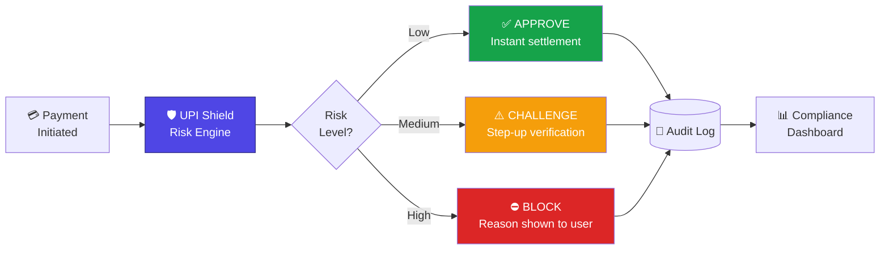
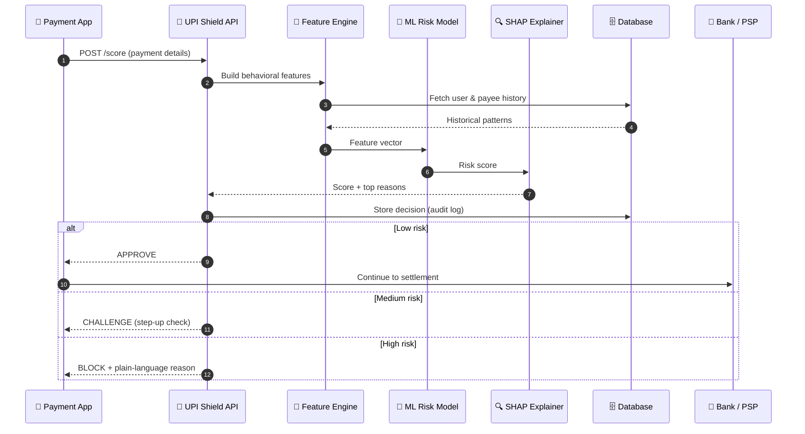
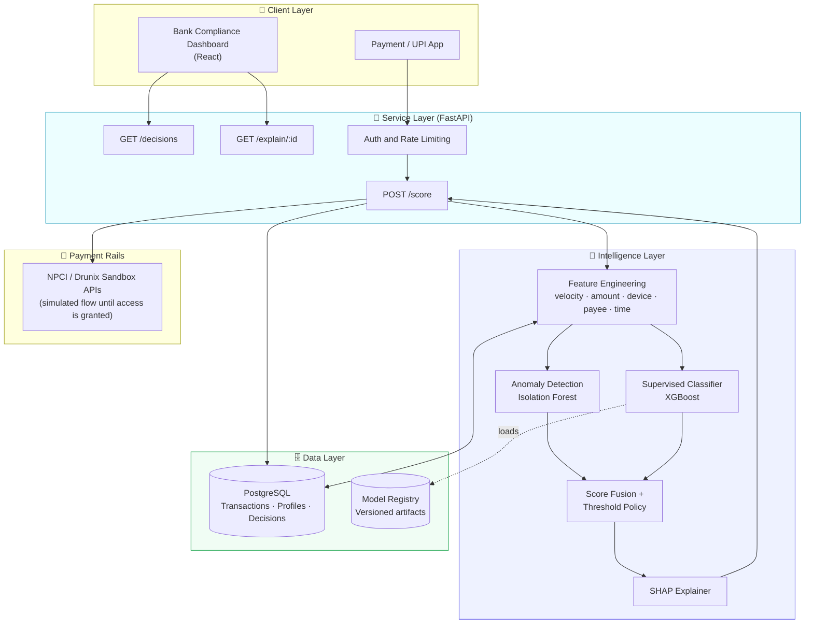
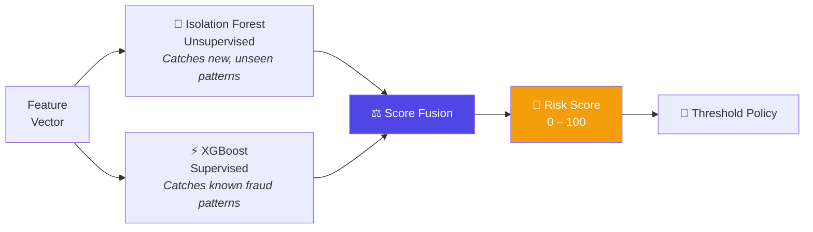
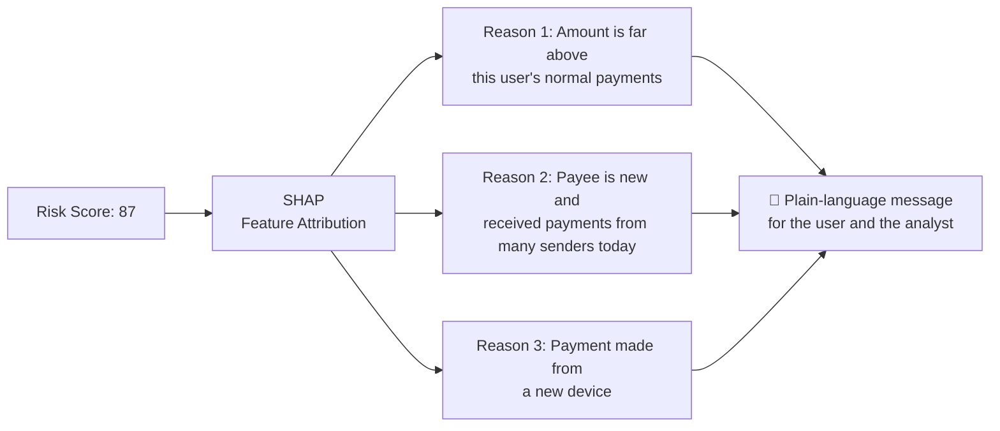
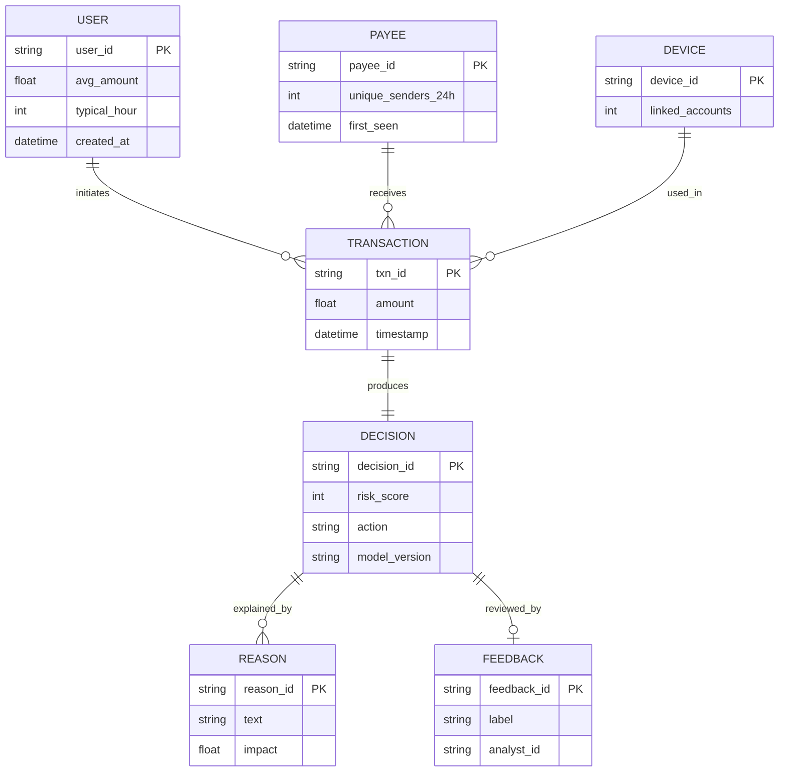
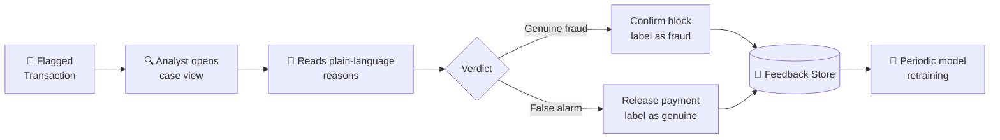
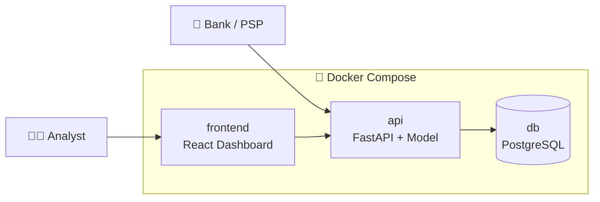
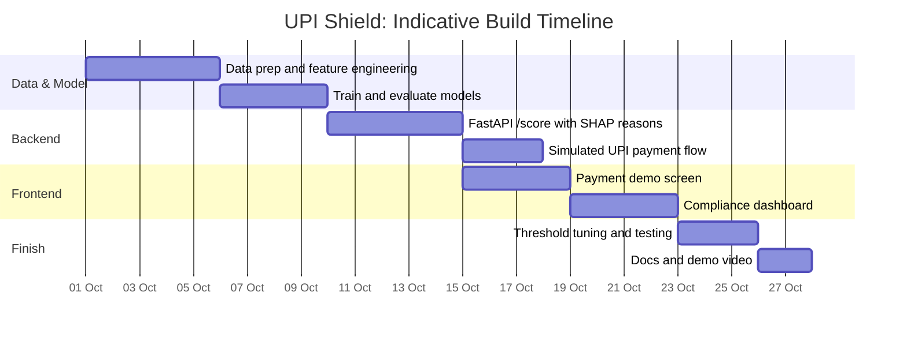

<div align="center">

# 🛡️ UPI Shield

### Real-time payments, protected in milliseconds, explained in plain language.

An explainable AI fraud layer that sits between payment initiation and settlement, so risky transactions are stopped **before** money moves, and every decision comes with a reason.


**Drunix Hackathon in collaboration with Citi · Problem Statement 1: Real-Time Payments**

</div>

---

## 📑 Table of Contents

1. [The Problem](#-the-problem)
2. [Our Solution](#-our-solution)
3. [How It Works](#-how-it-works)
4. [System Architecture](#-system-architecture)
5. [Risk Signals](#-risk-signals-what-the-model-looks-at)
6. [The ML Engine](#-the-ml-engine)
7. [Explainability](#-explainability-every-decision-has-a-reason)
8. [API Design](#-api-design)
9. [Data Model](#-data-model)
10. [Bank Compliance Dashboard](#-bank-compliance-dashboard)
11. [Security, Privacy & Governance](#-security-privacy--governance)
12. [Deployment](#-deployment)
13. [Evaluation Plan](#-evaluation-plan)
14. [Why UPI Shield Is Different](#-why-upi-shield-is-different)
15. [Business & Social Impact](#-business--social-impact)
16. [Roadmap](#-roadmap)
17. [Repository Structure](#-repository-structure)
18. [Getting Started](#-getting-started)

---

## 🚨 The Problem

India's real-time payment rails settle in **seconds**. Fraudsters exploit that same speed.

| Pain point | What happens today |
|---|---|
| **Detection is late** | Fraud is often identified only after funds have already moved, making recovery slow and uncertain. |
| **Rules are rigid** | Static rule-based systems miss new fraud patterns and block genuine customers by mistake. |
| **Decisions are opaque** | A blocked user gets no explanation, so trust drops and support tickets rise. |
| **Compliance is manual** | Analysts review flagged transactions without clear reasoning, which slows every case. |

> **The gap:** payments are instant, but protection and explanation are not.

---

## 💡 Our Solution

**UPI Shield** is a real-time risk engine exposed as a single API. For every payment it:

1. ⚡ **Scores** the transaction for fraud risk in milliseconds
2. 🚦 **Decides** to **Approve**, **Challenge** or **Block**
3. 🗣️ **Explains** the decision in plain language
4. 📊 **Logs** everything for compliance review



**Genuine users feel nothing. Fraudsters get stopped. Everyone gets a reason.**

---

## ⚙️ How It Works



---

## 🏗️ System Architecture



---

## 🔎 Risk Signals: What the Model Looks At

| Category | Example signals | Fraud pattern it catches |
|---|---|---|
| **Amount** | Ratio to user's usual amount, round-number amounts, just-below-limit amounts | Account takeover, structuring |
| **Velocity** | Payments in last 1 min / 1 hr / 24 hr, burst frequency | Rapid drain of accounts |
| **Payee** | New payee, payee seen across many senders, payee age | Mule accounts, scam collection accounts |
| **Device** | New or changed device, multiple accounts on one device | SIM swap, device farms |
| **Time** | Unusual hour for this user, sudden change in usage rhythm | Off-hours takeover attempts |
| **Behavior** | Deviation from the user's own historical profile | Anything that "doesn't look like them" |
| **Sequence** | Small test payment followed by a large payment | Probing before the real attack |

---

## 🤖 The ML Engine

UPI Shield combines two complementary models so it handles both **known** and **unknown** fraud.



| Model | Role | Why it is here |
|---|---|---|
| **Isolation Forest** | Unsupervised anomaly detection | Fraud evolves. This flags behavior that is unusual even without labeled examples. |
| **XGBoost** | Supervised classification | Strong performance on tabular payment data; learns known fraud signatures. |
| **Score fusion** | Weighted combination | Balances novelty detection with known-pattern accuracy. |

### Threshold policy (configurable defaults)

| Risk score | Decision | User experience |
|---|---|---|
| **0 – 39** | ✅ Approve | Payment goes through instantly |
| **40 – 74** | ⚠️ Challenge | Step-up verification (PIN / OTP / confirmation) |
| **75 – 100** | ⛔ Block | Payment held; clear reason shown; analyst notified |

Banks can tune these thresholds to match their own risk appetite.

---

## 🗣️ Explainability: Every Decision Has a Reason

Black-box blocking destroys trust. UPI Shield uses **SHAP** to turn model output into human-readable reasons.



**Example user-facing message:**

> *"We paused this payment because the amount is much higher than your usual transfers and the receiver is new to you. Please confirm it's really you."*

**Example analyst view:** ranked contributing factors with their impact on the score, so review takes seconds instead of minutes.

---

## 🔌 API Design

### `POST /score`

**Request** *(illustrative)*

```json
{
  "transaction_id": "txn_001",
  "sender_id": "user_123",
  "payee_id": "payee_456",
  "amount": 48000,
  "currency": "INR",
  "device_id": "dev_789",
  "timestamp": "2026-10-05T02:14:00+05:30"
}
```

**Response** *(illustrative)*

```json
{
  "transaction_id": "txn_001",
  "risk_score": 87,
  "decision": "BLOCK",
  "reasons": [
    "Amount is far above this user's normal payments",
    "Payee is new and received payments from many senders today",
    "Payment initiated from a new device"
  ],
  "model_version": "v0.1.0"
}
```

### Other endpoints

| Endpoint | Purpose |
|---|---|
| `GET /decisions` | List recent decisions with filters (for the dashboard) |
| `GET /explain/{transaction_id}` | Detailed feature attribution for one transaction |
| `POST /feedback` | Analyst marks a decision as correct or incorrect (feeds retraining) |
| `GET /health` | Service health check |

---

## 🗃️ Data Model



---

## 📊 Bank Compliance Dashboard

A React dashboard for risk and compliance teams:

| Panel | What it shows |
|---|---|
| **Live feed** | Incoming transactions with risk score and decision |
| **Flagged queue** | Challenged and blocked payments awaiting review |
| **Case view** | Full explanation with ranked reasons for each decision |
| **Trends** | Fraud patterns over time, top risky payees and devices |
| **Feedback loop** | One-click "correct / false alarm" to improve the model |



---

## 🔐 Security, Privacy & Governance

| Area | Approach |
|---|---|
| **Data minimization** | Only the fields needed for scoring are used; identifiers are hashed or tokenized in the data layer. |
| **Auditability** | Every decision is stored with score, reasons and model version for full traceability. |
| **Access control** | API authentication and role-based access on the dashboard. |
| **Fairness** | Decisions rely on behavioral signals, and sensitive personal attributes are excluded from the model. |
| **Human in the loop** | Borderline cases go to step-up verification or analyst review instead of automatic denial. |
| **Model governance** | Versioned models, so any decision can be traced to the exact model that made it. |

---

## 🐳 Deployment



One command brings up the full stack. The scoring service is stateless and can be scaled horizontally behind a load balancer.

---

## 📏 Evaluation Plan

We will measure the system honestly on held-out data and report the results from our own runs.

| Metric | Why it matters |
|---|---|
| **Precision** | Of the payments we flag, how many are truly fraud? |
| **Recall** | Of all fraud, how much do we catch? |
| **F1 and PR-AUC** | Balanced view on heavily imbalanced fraud data |
| **False positive rate** | Genuine users wrongly blocked (direct cost to trust) |
| **Latency (p95)** | Must fit within a real-time payment flow |
| **Explanation quality** | Are the reasons understandable to users and analysts? |

**Design goals:** low-latency scoring suitable for real-time flows, and a false-positive rate low enough that genuine users rarely notice the system.

---

## 🆚 Why UPI Shield Is Different

| | Traditional rule engines | Typical black-box ML | **UPI Shield** |
|---|---|---|---|
| Catches new fraud patterns | ❌ | ✅ | ✅ |
| Catches known fraud patterns | ✅ | ✅ | ✅ |
| Explains every decision | ⚠️ Rule ID only | ❌ | ✅ Plain language |
| Adapts to each user's behavior | ❌ | ⚠️ | ✅ |
| Analyst feedback loop | ❌ | ⚠️ | ✅ |
| Plugs in through one API | ⚠️ | ⚠️ | ✅ |
| Real-time, before settlement | ✅ | ⚠️ | ✅ |

---

## 🌍 Business & Social Impact

| Stakeholder | Impact |
|---|---|
| **Banks and PSPs** | Lower fraud losses, fewer false declines, faster and more consistent compliance review |
| **Users** | Safer payments, clear reasons when something is held, fewer support headaches |
| **Regulators and ecosystem** | Auditable, explainable decisions that support trust in India's digital payments growth |
| **Citi-aligned focus** | Strengthens risk management and digital banking experience |

### Future scope

- 🕸️ **Graph analytics** to detect mule-account networks
- 🌐 **Cross-border payments** extension for remittance fraud
- 🗣️ **Vernacular and voice alerts** to support financial inclusion
- 🔒 **Federated learning** so banks can improve models without sharing raw data
- 📱 **On-device risk signals** for faster, privacy-preserving scoring

---

## 🗺️ Roadmap



| Phase | Deliverable |
|---|---|
| **1. Foundation** | Dataset preparation, feature engineering, baseline models |
| **2. Core engine** | Working `/score` endpoint with explainable reasons |
| **3. Experience** | Payment demo and compliance dashboard |
| **4. Polish** | Tuning, testing, documentation, demo video |

---

## 📁 Repository Structure

```
upi-shield/
├── README.md
├── data/               # sample or synthetic datasets
├── model/              # training notebooks and saved models
├── api/                # FastAPI scoring service
│   ├── main.py
│   ├── features.py
│   ├── scoring.py
│   └── explain.py
├── frontend/           # React demo and dashboard
├── docs/               # architecture diagrams and notes
└── docker-compose.yml
```

---

## 🚀 Getting Started

```bash
# 1. Clone
git clone https://github.com/parthkharat20/upi-shield.git
cd upi-shield

# 2. Run everything with Docker
docker compose up --build

# 3. Or run pieces individually
# API
cd api && pip install -r requirements.txt
uvicorn main:app --reload

# Frontend
cd ../frontend && npm install && npm start
```

Try the API:

```bash
curl -X POST http://localhost:8000/score \
  -H "Content-Type: application/json" \
  -d '{"transaction_id":"txn_001","sender_id":"user_123","payee_id":"payee_456","amount":48000,"currency":"INR","device_id":"dev_789","timestamp":"2026-10-05T02:14:00+05:30"}'
```

> The commands above become runnable as the prototype code lands in this repository, following the roadmap.

---

<div align="center">

### 🛡️ Fast payments deserve fast protection.

**UPI Shield** · Built for the Drunix Hackathon in collaboration with Citi

</div>
